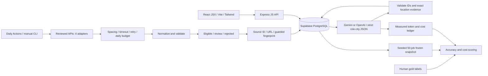

# FresherJobs AI
A real-data fresher job board for candidates in India, built with React .jsx, Vite, Tailwind CSS, Node.js/Express .js, Supabase PostgreSQL and Vitest.

Current verified snapshot (2026-11-20): **870 stored records; 375 eligible, 271 review, 224 rejected** after an evidence-based rule audit. There are no fake seed jobs. Eligibility is automated and conservative; source presence does not independently prove an employer still accepts applications.

The application, four-source ingestion, structured Gemini/OpenAI tagging, evaluation commands, migrations and Actions workflow definitions are implemented. Live Gemini authentication and tagging were verified on five public jobs plus ten evaluation snapshots with measured usage. Subsequent calls returned 503 (and one timed out); the bulk tagging run is not complete. Human labels and an IPv4 GitHub database connection are still pending. An acceptance report deliberately remains incomplete until those checks pass.

## Run the app
Requires Node.js matching package.json (Node 24 recommended), npm, Supabase PostgreSQL.
```powershell
npm ci
npm run db:migrate
npm run dev
```
Open http://127.0.0.1:5173. Express runs on port 3001; Vite proxies /api.
Copy .env.example to .env only when creating a new environment. Set DATABASE_URL and DATABASE_CA_FILE locally. This project already has a configured local .env; do not overwrite it.
Use the session pooler on 5432 or a reachable direct connection. Transaction pooling is incompatible with the ingestion advisory lock. Passwords must be URL-encoded and TLS certificates verified. The migration runner validates/baselines an already-created initial schema and applies subsequent migrations once; it does not drop tables.

## Phase 1 — ingestion
```powershell
npm run ingest
npm run ingest -- --require-target
npm run report -- --out artifacts/acceptance.json
```
ENABLED_SOURCES selects reviewed adapters: remotive,jobicy,remoteok,himalayas.
Override for a run with --sources remotive,jobicy,remoteok,himalayas.
--dry-run makes real API requests without storage or cross-process cooldown enforcement; avoid repeated live dry runs.
--max-pages N sets a bounded pagination cap. If more pages remain, the run reports partial and exits nonzero rather than pretending the feed is complete.

Source-specific IDs, canonical URLs and conservative company/title/location/type fingerprints prevent duplicates. Fingerprints merge across sources only when substantial descriptions match exactly and source dates are close; separate same-source requisitions are preserved.
Request budgets are persisted per UTC day, retries honor Retry-After, sources have cooldowns and per-request spacing, and concurrent ingestion is locked. Source transactions preserve existing jobs on failures.
Explicitly expired, stale, senior-only and irrelevant listings are rejected. Ambiguous geography/experience is retained for review.
Himalayas provides source seniority, country/timezone eligibility and expiry. Its pubDate is a last-updated timestamp; the frontend labels dates Listed, not original Posted.
Run npm run review:eligibility to reapply the current rules to stored records without refetching or fabricating records.
See docs/source-policy.md for permission reviews and exact attribution requirements.

## Phase 2 — Gemini/OpenAI tagging
Set locally:
```dotenv
LLM_PROVIDER=gemini
GEMINI_API_KEY=your_actual_key
LLM_MODEL=gemini-3.5-flash-lite
TAGGING_BATCH_SIZE=5
TAGGING_DELAY_MS=6500
TAGGING_MAX_COST_USD=2
```
Then:
```powershell
npm run tag -- --check-config
npm run tag -- --limit 500
```
The chosen Gemini model has a recorded standard paid-tier pricing snapshot. Costs are estimates from actual measured tokens, not invoice charges or invented token counts. Explicit rate overrides are available in .env.example; for a free-tier cost basis, configure explicit zero rates only when that matches your account.
For OpenAI set LLM_PROVIDER=openai, OPENAI_API_KEY, an accessible LLM_MODEL, and explicit input/cached/output USD-per-million rates. Never put keys in VITE_ variables.

Tags use strict JSON Schema and runtime validation, a bounded role taxonomy and exact evidence quotes. The model can only select cities found in credible work-location evidence; country/timezone/headquarters are not cities. Ambiguous/missing cities stay Unknown. No eligibility decisions are delegated to the LLM.
Calls are batched, timeout-bounded and budgeted. LLM_TIMEOUT_MS (1000?180000) and optional Gemini LLM_THINKING_LEVEL can tune bounded latency; thinking settings are saved with pricing metadata. Successful unchanged content is cached. Ingestion retains tags for unchanged input and invalidates them when relevant content changes.
Measured usage is recorded before JSON/evidence validation, including invalid model responses. Missing usage stays unknown and stops further spend; summaries distinguish known measured cost from an unknown total, and evaluation reports expose an observed lower-bound cost separately; billed requests are not automatically retried.
Thinking tokens count toward Gemini output usage. Cached input is priced separately.

## Evaluation — 50 real jobs
A fixed eligible sample exists locally under artifacts/evaluation-v1.
Set: 0e4f1cfd-82e5-4f2d-997a-ea42c0eaaf11. Human labels are deliberately blank.
Read jobs.json and fill role/city in labels.json using the taxonomy in manifest.json. Do not use model predictions as gold labels.
```powershell
npm run evaluate -- tag --set 0e4f1cfd-82e5-4f2d-997a-ea42c0eaaf11
npm run evaluate -- score --set 0e4f1cfd-82e5-4f2d-997a-ea42c0eaaf11 --labels artifacts/evaluation-v1/labels.json --out artifacts/evaluation-v1/results.json
```
Create a new sample:
```powershell
npm run evaluate -- export --seed takehome-v1 --scope eligible --size 50 --out artifacts/evaluation-new
```
Seeded SHA-256 ranking is deterministic over the same population. Frozen database snapshots prevent later source updates from changing evaluation inputs.
The scorer reports role accuracy, city accuracy, joint accuracy and cost/1000 posts from actual recorded usage (including invalid/repeated evaluation calls). It rejects incomplete labels, foreign/duplicate IDs and absent predictions. Unknown usage yields null cost, never fabricated zero. Existing label/output files are not silently overwritten.
See docs/evaluation.md. The current sample files are local artifacts, not committed source or redistributed job feeds.

## Phase 3 — frontend and API
The responsive UI includes real job cards, search, role/city/type/workplace filters, pagination, original application links, source attribution, counts, refresh status, and loading/empty/error states.
Public jobs must be eligible, active, not explicitly expired, within MAX_JOB_AGE_DAYS (30), and source-confirmed within 48 hours.
Reload jobs refreshes the database view, not external feeds. No signup wall is used. Source HTML is converted to plain text and never injected into React.
Missing role/city remains Unknown until validated tags exist.

GET /api/jobs accepts page (1–10000), limit (1–100, default 12), keyword, role, city, type and location_type.
type: full_time, part_time, internship, contract, freelance, Unknown.
location_type: remote, hybrid, onsite, Unknown. City/role values come from GET /api/stats.
Keywords are literal case-insensitive substrings with SQL wildcards escaped. Queries are parameterized; invalid/repeated/unknown parameters return 400.
GET /api/stats returns current counts, facets, source states, last_successful_refresh and latest_run.
GET /api/health checks database readiness and returns 503 on failure.
API responses use rate limits, no-store caching, security headers and sanitized errors.

## Phase 4 — CI and daily automation
.github/workflows/ci.yml runs checks/tests/build and production dependency audit.
.github/workflows/ingest.yml runs daily at **02:17 UTC / 07:47 India**, plus manual dispatch. It migrates, ingests, tags and uploads a sanitized acceptance artifact.
Repository: https://github.com/MunafMoon/Job-Portal-Project
Required Actions secrets: DATABASE_URL, DATABASE_CA_PEM (certificate contents), GEMINI_API_KEY.
The workflow is pushed to main and CI has passed. The verified IPv4 session-pooler override is now configured in GitHub Actions. Database migration and ingestion passed remotely in run 44746848948. The Gemini key is encrypted in Actions; tagging remains blocked by provider HTTP 503 and real manual labels are still pending. The workflow must be on the default branch and all secrets configured before a successful remote run. Local files alone do not activate a schedule.
Failures and acceptance shortfalls remain visible; no step pads data. Missing AI credentials/manual evaluation intentionally prevents a false complete report.
See docs/automation.md for setup and limits.

## Architecture


## Checks
```powershell
npm run check
npm test
npm run build
npm run report -- --require-complete
```
Tests use deterministic synthetic fixtures only; no API keys/database are required. Real acceptance checks use actual source data and provider usage.
With Chrome installed and a running local app, npm run test:browser checks desktop/390px/320px layout and interactions without downloading a browser. CHROME_PATH can override the executable; BROWSER_TEST_URL can target production.
A complete acceptance gate requires multiple successful sources, 200 public jobs, tagged public jobs, measured live LLM usage, a fully labeled/predicted 50-job evaluation and no latest source failures.

## Deployment
On a Node-capable host, npm ci then npm run build. Supply server-only database/provider settings and a readable CA file.
Set HOST=0.0.0.0 and the host's PORT, then npm start. Express serves client/dist and /api together; terminate HTTPS at the host's proxy.
Use npm run db:migrate before first startup. The browser uses Express only: no Supabase/LLM secrets or browser RLS policies are needed.
If using a separate static host, route /api through an HTTPS reverse proxy; Vite's dev proxy is not a production proxy.
Configure Express trust proxy to the known host topology, and use a shared rate-limit store for multiple backend instances.
Starting the web process does not ingest. Activate the separate daily workflow and confirm /api/health, /api/stats and the workflow artifact.

## Troubleshooting
- API unavailable: check .env, verified TLS/CA and /api/health. Restart after environment changes.
- Migration relation already exists: use the migration runner; do not delete tables or rerun 001 manually.
- Empty/low public count: review/rejected/stale/expired/unconfirmed records are excluded; inspect report and source logs.
- SOURCE_PAGE_LIMIT_REACHED: increase the configured page cap within rate budgets on a later allowed run. Partial counts are not full-feed counts.
- HTTP 429: respect Retry-After and slow the source. Do not bypass challenges or rotate identities.
- SOURCE_DAILY_BUDGET_EXHAUSTED / rate_limit_window: wait for the permitted window; retries count against the budget.
- LLM_API_KEY_REQUIRED: add the provider key locally (or GitHub Actions secret); never paste it into browser code.
- LLM_PRICING_REQUIRED: supply explicit rates for a non-catalog model.
- Invalid model output: inspect sanitized tagging_requests status; usage/cost remains recorded; existing classifications are not replaced with guesses.
- Evaluation labels/predictions missing: complete the manual labels and real provider tagging. No accuracy is invented.
- OUTPUT_EXISTS_PRESERVE_MANUAL_LABELS: use a new directory/filename or keep your labeled files intact.
- Workflow not active: confirm default branch, Actions permissions and repository secrets. Schedules can be delayed.
- Process killed: inspect unfinished ingestion_runs/tagging_requests. Database advisory locks release on disconnect.
